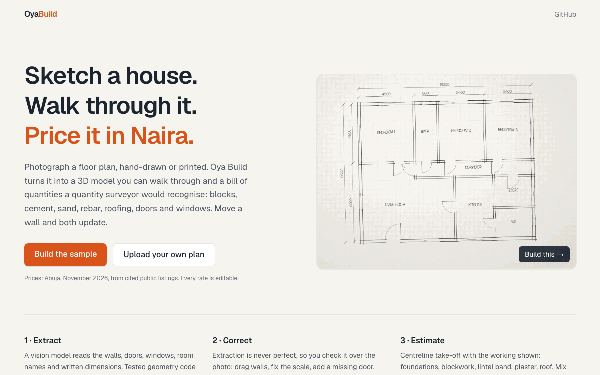

# Oya Build

**Sketch a house. Walk through it. Price it in Naira.**

Photograph a floor plan, hand-drawn or printed. Oya Build turns it into a 3D model you can walk
through and a bill of quantities (BoQ) a quantity surveyor would recognise: blocks, cement, sand,
granite, rebar, roofing, timber, doors and windows, priced from a dated Abuja price book. Move a wall
and the 3D model and the cost update together.

<!-- demo:start -->
**Live: [oya-build.vercel.app](https://oya-build.vercel.app)**. Try **Build the sample**, drag a wall, then **Walk**.



<sub>Recorded with `pnpm --filter web demo:gif` against a production build. The sample replays a real recorded
extraction, including its one miss (a short corridor wall, highlighted in amber for you to draw in).</sub>
<!-- demo:end -->

## The 15-second demo

1. **Build the sample**: a hand-drawn three-bedroom bungalow sketch.
2. The extracted plan appears over the photo, walls rise in 3D, and the BoQ counts up to the total.
3. Drag a wall: the 3D model and the total move together (the change is shown as `+₦…`/`−₦…`).
4. **Walk**: first-person view from the front door (WASD/arrow keys). **Full view** hides the side panels;
   **Style** changes roof sheet colour, wall paint and floor finish (cosmetic only).
5. Select a door or window to change its type (flush, hardwood panel or steel doors; casement or sliding
   windows). Those are priced, and "Use this for all similar" applies it across the plan.

## How it works

```
photo ──► /api/extract ──► raw geometry (pixels) ──► post-processing ──► Plan (mm) ──┬─► 2D editor (you correct it)
          Claude vision      walls, openings,        square, join, split,             ├─► 3D model (react-three-fiber)
          structured output  rooms, dimensions       scale from dimensions            └─► take-off ──► priced BoQ
```

- **The corrected plan is the source of truth** ([ADR-0001](docs/adr/0001-plan-model-is-source-of-truth.md)).
  A wall graph in integer millimetres; rooms are derived as faces of the planar graph, so moving a wall
  can never leave the rooms, the 3D model and the bill out of step.
- **Extraction describes, code decides** ([ADR-0002](docs/adr/0002-vision-extraction-with-correction.md)).
  The model returns what is drawn in pixel coordinates (validated by a JSON schema). Deterministic, tested
  code squares near-axis walls, merges strokes, snaps junctions and takes the scale from the median of
  the written dimensions. You always get a correction step, with low-confidence items flagged.
- **Quantities with the working shown** ([ADR-0003](docs/adr/0003-estimation-engine.md)).
  Centreline method; openings and the lintel band deducted from blockwork; concrete from mix ratio ×
  1.54 dry-volume factor; every line shows its formula, and every assumption is editable. The engine is
  checked against [hand calculations](packages/estimate/test/worked-examples.md) made by an
  [independent script](packages/estimate/test/handcalc.py), to ±0.5%.
- **3D without CSG** ([ADR-0004](docs/adr/0004-3d-rendering-and-walkthrough.md)): walls are built as
  boxes around openings, so dragging a wall rebuilds in real time.
- **No database in v1** ([ADR-0005](docs/adr/0005-stack-hosting-and-eval-in-ci.md)): plans live in your
  browser and in share links (in the URL fragment, never sent to the server). Uploaded photos aren't stored.

## Prices

[`packages/estimate/price-books/abuja-2026-11.json`](packages/estimate/price-books/abuja-2026-11.json):
one rate per material with its unit, source URL and the date it was read. Most rates come from a
public Abuja rate book dated 7 November 2026; gaps are filled from other cited listings and marked as
proxies where no direct price was found. **Naira prices move fast. These are indicative**, and the app
shows the price-book date next to every total. Type your own supplier quote over any rate. Adding a
city or a month is a data-only change.

What the estimate covers: substructure (excavation, footing, blockwork to DPC, fill, DPM, oversite
slab), walls and lintel band, plaster and screed, roof covering, roof timber (rule of thumb), PVC
ceiling, doors and windows. **Not included**: labour (unless you add a %), electrical, plumbing,
tiles, paint, external works, fees, VAT. It is a first-pass estimate for single-storey buildings, not
a substitute for a QS or a structural engineer.

## Accuracy

Measured, not claimed. [`eval/`](eval) holds plans with known dimensions and the harness that scores
extraction against them, **before** any human correction:

- **Wall F1**: length-weighted; a stretch of wall counts as found when it lies within 300 mm of a true wall.
- **Door/window F1**: same kind, centre within 500 mm.
- **Scale error**: extracted mm-per-pixel against the true one.
- **Estimate error**: the BoQ total priced from the raw extraction against the total from the true plan
  (same engine, same prices), so it isolates the error extraction introduces.

<!-- eval:start -->
Run 2026-11-21 · claude-opus-5-5 (prompt 2026-11-21.1) · medians per category, before any human correction.

| Plans | n | Wall F1 | Door/window F1 | Scale error | Floor-area error | Estimate error (median / worst) | Cost per plan | Time per plan |
|---|---|---|---|---|---|---|---|---|
| Real hand sketches (phone photos) | 3 | 0.77 | 0.71 | not scored¹ | 4.5% | 6.4% / 6.7% | $0.090 | 32 s |
| Synthetic, printed style | 8 | 1.00 | 1.00 | 0.2% | 0.0% | 0.4% / 6.1% | $0.053 | 15 s |
| Synthetic, sketch style | 8 | 1.00 | 1.00 | 0.7% | 0.5% | 0.3% / 4.7% | $0.057 | 18 s |

¹ The true scale of a photographed sketch isn't known exactly, so scale error is only scored on the synthetic plans; its effect still shows in the area and estimate errors.
<!-- eval:end -->

What these numbers are and aren't:
- The 16 synthetic plans (8 layouts × clean/sketch) are drawn by [our own renderer](eval/src/render.ts).
  They are far easier than real drawings, which is why they score near-perfectly. Don't read them as
  real-world accuracy.
- The 3 real sketches are photos of drawings in different styles (marker sketch with furniture,
  architect's concept sketch, pencil measured drawing), from Unsplash under the
  [Unsplash License](https://unsplash.com/license). Their true plans were entered by hand from the
  written dimensions ([eval/src/real-cases.ts](eval/src/real-cases.ts)), ±300 mm where a position isn't
  dimensioned. CI replays all 19 recorded extractions.
- The evaluation set guided two fixes to the clean-up code: joining hand-drawn corners that miss, and
  treating only one external door as the steel entrance door. Those fixes are covered by unit tests,
  but the same cases then measured them, so a fresh set would be a fairer test.
- Small samples: read them as a direction, not a guarantee.
- **Not measured**: error against a real QS bill or a real build cost.

Run it yourself:

```bash
pnpm eval            # replay recorded model outputs and score them (free; runs in CI)
pnpm eval:live       # call the model on every case (needs ANTHROPIC_API_KEY; costs money)
pnpm eval:report     # update this table and the landing page from eval/results/latest.json
```

## Development

```bash
pnpm install
pnpm dev             # http://localhost:3000
pnpm test            # unit tests: geometry, estimate (hand-calc fixtures), scoring
pnpm typecheck && pnpm lint
pnpm build && pnpm --filter web test:e2e   # Playwright demo-path smoke test
```

Environment (Vercel project settings, or `apps/web/.env.local`):

| Variable | Purpose |
|---|---|
| `ANTHROPIC_API_KEY` | Live extraction. Without it the app still works with the sample, drawing, and visitors' own keys. |
| `KV_REST_API_URL`, `KV_REST_API_TOKEN` | Upstash Redis (Vercel Marketplace) for the rate limit and the daily spend counter. In-memory if absent. |
| `EXTRACT_DAILY_CAP_USD` | Daily spend cap on the app's own key (default `2`). Cost is computed from each response's token usage. |
| `EXTRACT_PER_IP_PER_HOUR` | Live extractions per IP per hour (default `5`). |

Layout:

```
apps/web            Next.js app: landing, /build workspace, /api/extract
packages/schema     Zod schemas: Plan, params (with reasons), raw extraction, price book
packages/geometry   wall graph, rooms/footprint, junction rules, editing ops, post-processing, 3D boxes
packages/estimate   take-off, pricing, price books, hand-calc fixtures
packages/extract    the vision call and prompt (shared by the API route and the eval)
eval                cases, renderer, scoring, record/replay harness
docs                spec and ADRs
```

## Stack

TypeScript (strict) · pnpm workspace · Next.js 16 on Vercel · react-three-fiber + drei · Zustand ·
Zod · Claude (vision, structured outputs) via the Anthropic SDK · Upstash Redis · Vitest · Playwright ·
GitHub Actions.

## Licence

MIT
